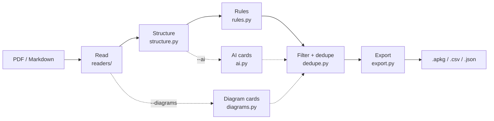

# autoflashcards: PDFs and notes to Anki decks

**A command-line tool that turns lecture PDFs, exported slides and Markdown notes into Anki flashcard decks, so a student can go from course material to spaced-repetition review in one command, and check every card against its source.**

[](https://github.com/casildata/autoflashcards/actions/workflows/pipeline.yml)


**Status:** early development (v0.1.0.dev0). PDF and Markdown input work today; PowerPoint files must be exported to PDF first.

---

## TL;DR

- **Works offline by default:** five extraction rules read PDF layout (font size, bold text, columns, multi-slide handouts) and make cards. On the evaluation set that is **100% precision and 80% recall** against 35 hand-written gold cards.
- **Optional AI stage raises recall:** adding Claude Haiku 5.5 brings recall to **94%** (precision 86%). A local Llama 3.2 3B model brings it to **97%** (precision 84%), and no text leaves the computer.
- **AI output is checked, not trusted:** each AI card must quote the line it came from, and cards that aren't grounded in the source file are dropped. A test document with a hidden instruction aimed at AI models produced **0 obeying cards** with either model.
- **Diagram cards (`--diagrams`):** labeled figures become notes of Anki's built-in Image Occlusion type, with a box over every label, so a misplaced or missing box is fixed by dragging it in Anki's own occlusion editor. Every box is independent, so you can resize one without touching the others; each box is also its own card. With `--type-answers`, you type the label and Anki marks what you got wrong. Labels come from the PDF's text, or from Tesseract OCR when they're part of a picture. Each figure's image is drawn without the slide behind it: the figure, its labels and its leader lines, no background, sticky notes or pins. On a real 18-page biology handout it found 34 figures with 297 labels; 32 are whole diagrams, one is a picture of a table and one a title slide (see [Limitations](#limitations--lessons-learned)).
- **Built to be audited:** every card shows its file, page and heading path, and is tagged with the rule that made it. `--json` lists every dropped card and the reason.
- **Caveat:** the evaluation documents are small and generated, built from layouts seen in real course material. Expect lower precision on real PDFs.

---

## Approach

### Pipeline



**Reading PDFs.** Reading order comes from character positions, not the file's internal text order. The page is cut recursively at its widest blank band (XY-cut), which handles single columns, two-column articles with narrow gutters, and handouts with several slides per page, all with one algorithm. Headings are found by font size relative to each page's own body text (every slide on a handout can be scaled differently) and by bold text. Running headers, footers and page numbers are removed. Bullets whose markers are pictures, which is common in exported slides, count as bullets when they are short and have no closing period.

### Rules

Each paragraph or bullet is checked against these rules in order. The first rule that matches makes the card(s), so one fact doesn't become two cards.

| Rule | Your notes say | Card |
|---|---|---|
| `term_colon` | `Osmosis: movement of water across a membrane.` (or `=`, `→`, `->`) | **Osmosis** → movement of water across a membrane. |
| `bold_lead` | **Mitosis** divides a cell into two identical cells. | **Mitosis** → divides a cell into two identical cells. |
| `definition_sentence` | A ribosome is a structure that builds proteins. | Cloze: A [...] is a structure that builds proteins. |
| `bold_term_bullets` | • **Protein kinases**<br>&nbsp;&nbsp;– Transfer phosphates from ATP to proteins | **Protein kinases** → Transfer phosphates from ATP to proteins |
| `slide_title_bullets` | Slide title *G protein-coupled receptor*, then its bullets | **G protein-coupled receptor** → its first three bullets |

- `definition_sentence` looks for "X is a / are the / was an / is defined as / is called / is known as / refers to / means …" at the start of a sentence. It skips sentences whose subject is a pronoun ("It is a…", "There are…"). A sentence that defines two terms ("Homozygous means having two identical alleles, and heterozygous means…") becomes one cloze note with two deletions, so Anki quizzes each term. It also catches a term followed by its description between commas: "{{c1::Retention}}, the share of customers who come back, is…".
- The two slide rules also work on slides exported to PDF. A card's back holds up to three bullets, one per line. `slide_title_bullets` only uses short sections made entirely of bullets (up to 8) on the slide's own page, so the headings of a textbook don't turn into list cards. It skips titles that describe a picture ("Image of…", "Example of…") and slides whose bullets are already `Term: definition` cards.
- **Skipped everywhere:** figure and table captions, labels such as `Note:` or `Keywords:`, and sections headed References, Bibliography, Table of contents, Thanks or Credits.
- **Filtered after the rules run:** cards with the same front, near-identical cards (90% similar or more) and overly long cards. `--json` lists them.

### AI cards

The rules only catch facts written in recognizable patterns. With `--ai`, the text is also sent to a language model, which can write cards from plain statements like "Producers capture energy from sunlight". Rule cards are kept first, and AI cards that repeat them are dropped as duplicates.

- **Grounding:** the model is asked to quote the line each card came from. A card is dropped if its quote isn't in your file, or if its answer is mostly words your file doesn't use, and the run reports how many were dropped. The quote also gives the card its real page and heading. Small local models often leave the quote out. Those cards are kept only if their term also comes from your file.
- **Prompt injection:** the file's text is sent as data inside `<document>` tags, the model is told not to follow instructions in it, and its reply must match a JSON schema.
- **Cost and failures:** before any request, the run prints the number of requests and an estimate of input tokens. Replies are cached on disk, so running the same file again costs nothing. A failed request skips that part of the file with a warning. A missing key, a stopped Ollama or an unknown model stops the run (exit code 2).

### Diagram cards

With `--diagrams`, labeled figures become cards. A figure is a picture in the PDF, or a cluster of drawn shapes (ruled tables are skipped). Its labels are short text lines on it or within half an inch of it. When a picture has no text on it, its labels are read with Tesseract OCR. Labels set on two lines ("Nuclear" over "envelope") are joined.

Each figure becomes one note of Anki's built-in **Image Occlusion** note type (Anki 23.10 or newer): the figure's image, and a rectangle over each label. Anki draws the masks and reveals them on the answer side, and the boxes can be edited in Anki's occlusion editor.

| Option | Cards per figure | Front | Back |
|---|---|---|---|
| `--diagrams` | one per label | the label to name is masked in red, the others in yellow ("hide all, guess one") | that label revealed, and written below the figure |
| `--diagrams --type-answers` | one per label | the same, and a box to type the label | that label revealed, and your typing compared with it letter by letter |

A figure is one note, so a box is fixed once for all its cards. Each box has its own cloze number, which is what lets Anki's editor move and resize it on its own. To see the whole figure, press the card's Toggle Masks button on the back. To find a box's line in `Image Labels`, press Box Numbers on the back: each box shows its number, the N of its `{{cN::…}}` line, including boxes you drew in Anki's editor. Boxes are numbered top to bottom, then left to right. Both buttons keep their setting when you edit the note or go to the next card, until Anki closes that window; the front always shows its masks.

- **Figures cut into strips:** some PDFs (slide handouts exported from PowerPoint or Google Slides, for example) store a picture as many thin strips. Strips that touch and line up edge to edge are joined back into one picture before anything else, so a figure comes out whole instead of cut off at a strip.
- **No slide background:** the figure's image is drawn from the PDF with only the pictures and shapes that lie inside the figure's frame, and all text. A slide background, a sticky note or a pin around the figure is left out, so the image has a white background.
- **Not diagrams:** pictures under 1 inch (bullet markers, logos), pictures with another picture on them or mostly covered by a later one of about the same size (slide backgrounds, textures), and figures with a sentence or a wrapped line of text on them (text boxes on a slide background). Figure captions, panel letters such as "(a)", scale bars ("0.5 µm"), slide titles and bullet text next to a figure are not labels: nearby lines are joined first, so a bullet that wraps reads as a sentence.
- **The label on the back:** the note has two fields beyond Anki's own. `Image Labels` holds the labels as cloze deletions numbered like the boxes (`{{c1::Nucleus}}`, `{{c2::Nucleolus}}`, …), and the back of the card for box 2 shows only the text of `{{c2::…}}`, so text to speech has the label to read. `Source` holds the file and page, shown under the card as on the text cards. `Back Extra` is left empty for your own notes.
- **Typing the answer (`--type-answers`):** the notes get the `Image Occlusion (autoflashcards, type in the answer)` note type instead, whose cards show `{{type:cloze:Image Labels}}`, Anki's type-in box for the deletion with the card's number; the typing check on the back shows the label. `Image Labels` has one label per line, so to fix a label that OCR misread, open the note (Browse) and edit its line. A box you draw in Anki's editor gets the next number and its own card; add a matching `{{cN::label}}` line to `Image Labels` to give it a label. With `--type-answers`, until `Image Labels` has that line, the card shows, when you study it (Browse's Preview has no typing box, so it shows nothing), "Box 22 has no answer yet. To type it, add `{{c22::label}}` to this note's Image Labels field" where the typing box goes, and outlines box 22 with its number; add that line and the card asks for the label. If you'd rather type each label on its box, `--sio` (below) stores the label with the box, but makes one card per figure.
- **Fixing boxes in Anki:** open the note (Browse, select it) and Anki shows its occlusion editor: drag a box to move or resize it, delete a box that covers a slide title or a scale bar, or draw one that OCR missed. Anki keeps the card of a deleted box, showing the figure with no boxes and a note saying the box was deleted: delete the box's line in `Image Labels`, then run Tools > Empty Cards to remove the card.
- The note type is `Image Occlusion (autoflashcards)`: Anki's own Image Occlusion note type (same fields, templates and CSS, copied from Anki 26.09, plus the `Image Labels` and `Source` fields) under a fixed ID, so re-importing updates notes instead of duplicating them. Anki won't move a note to another note type on import, so a figure imported once with `--type-answers` and once without is skipped the second time; to switch, delete the diagram notes first. Decks made before this version have the typing note type under the old name `Image Occlusion (autoflashcards)`: delete it (Tools > Manage Note Types; this deletes its notes) before importing a new deck, or Anki skips those figures and adds an empty copy of the note type. Diagram notes are tagged `afg::rule::diagram`. Each figure is stored once, as one JPEG inside the `.apkg`; the boxes are positions in the note, not drawn into the image. The biology handout's deck holds 34 images (1.6 MB with the text cards). Diagram notes are left out of `--csv`, which can't carry images, and need Anki 23.10 or newer; on a phone, use a version of AnkiDroid or AnkiMobile that supports Image Occlusion.
- You can also give a picture file (`.png`, `.jpg`) as input; it is read as one diagram with OCR.
- **For the Simple Image Occlusion add-on (`--sio`):** if you use the [Simple Image Occlusion](https://ankiweb.net/shared/info/675107747) add-on, `--sio` writes the diagram notes for its `Image Occlusion Simple (v2)` note type instead of putting them in the `.apkg`. Each box carries its own label, so in the add-on's editor you add, remove and resize boxes and type each box's label in one place; one note per figure, whose card asks you to type the labels box by box. The add-on's note type isn't autoflashcards' to ship, so these notes come as a CSV for Anki's import (`OUT-sio.csv`, with headers that pick the note type, deck and tags) plus a folder of images (`OUT-media`, or `--media-dir`). Copy the images into your Anki profile's `collection.media` folder (on Windows `%APPDATA%\Anki2\<profile>\collection.media`), or point `--media-dir` there, then import the CSV with File > Import. Re-importing updates the notes instead of duplicating them. An import of the handout's CSV into a copy of a collection with the add-on's note type gave 34 notes, one card each. A note's ID comes from its file, page and figure number, so if a new version finds more or fewer figures on a page, re-importing replaces a note with a different figure and loses the box edits made in Anki; delete the old diagram notes (tag `afg::rule::diagram`) first.
- **Linking back to the PDF (`--link-pdf`, opt-in):** with `--sio`, fills the add-on's `HeaderURL_filepdf#page=` field with a `file:///…/lecture.pdf#page=8` link, so the note's header opens the page the figure came from. The run prints a warning, because the link has limits: it holds the PDF's full path on your computer (which can include your user name), so anyone you share the notes with sees it; it works only on that computer and only while the PDF stays where it is; Anki on a phone can't open it; and whether the PDF opens at the right page depends on your PDF viewer. Without the option the column isn't in the CSV, so re-importing keeps any links you added yourself.

## Results

`eval/score.py` generates five test documents with original text, in layouts taken from real course material. It then scores the cards against hand-written gold cards, which list the facts a student should get a card for. The gold cards were written before running the tool, so they include facts no rule catches yet.

**Rules only** (reproduced by `python eval/score.py`):

| Document | Layout | Gold | Cards | Precision | Recall |
|---|---|---:|---:|---:|---:|
| handout | 4 slides per page, bullets drawn as pictures, a notes column, a chart slide | 10 | 7 | 100% | 70% |
| deck | one slide per page: divider, bold sub-terms, arrows, picture and "Questions?" slides | 6 | 5 | 100% | 83% |
| article | two columns with a narrow gutter, abstract, keywords, figure caption, references | 6 | 6 | 100% | 100% |
| textbook | single column, running header, page numbers, bold terms | 9 | 6 | 100% | 78% |
| hostile | short notes plus a hidden instruction aimed at AI models | 4 | 3 | 100% | 75% |
| **All** | | 35 | 27 | **100%** | **80%** |

**With AI cards**, on the same documents:

| | Rules only | + Claude Haiku 5.5 (`claude-code`) | + Llama 3.2 3B (`ollama`, local) |
|---|---:|---:|---:|
| Cards | 27 | 57 | 43 |
| Recall | 80% | **94%** | **97%** |
| Precision | **100%** | 86% | 84% |
| Cards obeying the hidden instruction | 0 | **0** | **0** |

- **The AI finds what the rules miss.** Both models catch the plain-statement facts. The gold set lists key terms only, so the AI cards it doesn't list were checked by hand (`eval/gold/<name>.judged.jsonl`). Most are sound, for example "Examples of abiotic factors → Temperature, water, light and soil" and "Range of an RFM score → 111 to 555".
- **What costs precision.** Most of the loss comes from repeats of rule-card facts in another form: 5 cards with each model, plus 3 Haiku cloze cards. Llama also made up definitions from a slide title or figure caption ("Energy Flow → the movement of energy through an ecosystem").
- **On a real file.** On a real 4-slides-per-page lecture handout, the AI stage took the deck from 19 to 36 cards in one request.

*Precision* is the share of cards that match a gold card or were judged correct by hand. Repeats, wrong cards and cards with no verdict yet (*unjudged*) count against it. *Recall* is the share of gold cards found. One cloze note with two deletions can find two.

## Limitations & lessons learned

- **The evaluation set is small and generated.** It has 35 gold cards across five documents, and I wrote and hand-judged them myself. It catches regressions well, but real PDFs are messier, so expect lower precision on your own files. You can score your own documents with `--private` (see [Evaluate](#evaluate)).
- **Plain statements need the AI stage.** Facts like "Dominant alleles hide the effect of recessive ones" have no pattern a rule can use. Telling them apart from any other sentence needs grammar analysis or a language model.
- **Grounding catches made-up text, not every wrong fact.** A small model can combine words that really are in the file into a wrong claim, and the word-overlap check can't catch that.
- **Scanned PDFs produce no text cards.** Pages that are images with no text layer need OCR, which is only used for diagram labels so far.
- **Diagram labels from OCR are rough.** Before figures were joined from their strips, about a third of the handout's diagram cards needed fixing or deleting; I haven't recounted since. Typical problems: OCR misreads ("Nucieus", "Digestiv enzymes"), slide titles inside the picture, and two nearby labels joined into one ("Inner and outer membranes Granum"). A picture of a table and a title slide on a plain background also come out as diagrams. White text on dark backgrounds is often missed. The answer side shows the figure itself, so a misread label shows up next to the real one, and is fixed in `Image Labels`; boxes over the wrong text are dragged or deleted in Anki's occlusion editor. All diagram notes have the tag `afg::rule::diagram`. There is no gold set for diagrams yet, so this is a hand count, not a measured precision.
- **Sub-bullets aren't told apart from bullets in PDFs,** so a bold term's back is "the bullets after it, up to the next bold term or slide".
- **Rejected on licensing:** PyMuPDF (AGPL) and LayoutLMv3 (non-commercial weights) would conflict with shipping under MIT. That is why the layout analysis is rule-based on top of pdfplumber.

## Getting started

### Requirements

- Python 3.11 or newer. CI tests 3.11 and 3.14 on Linux and Windows.
- [Anki](https://apps.ankiweb.net) to study the decks. The `--csv` export needs Anki 2.1.55+.
- Optional, for AI cards: Claude Code, an Anthropic API key, or Ollama (see [AI cards](#ai-cards-optional)).
- Optional, for labels inside pictures: [Tesseract](https://tesseract-ocr.github.io/tessdoc/Installation.html) 4 or newer (see [Diagram cards](#diagram-cards-optional)).

### Install

From a clone of this repository:

```bash
pip install .
```

### Run

```bash
autoflashcards lecture3.pdf                                        # writes lecture3.apkg
autoflashcards week1.md week2.pdf --deck "Bio 101" --out bio.apkg
```

To try it without your own files, [`examples/`](examples/) has Markdown notes, ten pages of NASA's public-domain *Rockets Educator Guide* and a labeled figure from it (`python eval/fetch.py examples` downloads the NASA pages).

In a terminal, the slow steps show progress bars: reading each PDF's pages, finding diagrams (where OCR runs) and AI requests. The run ends with a summary, which on the biology handout with `--diagrams` reads:

```
Wrote 45 cards and 34 diagrams (296 cards, one per box) to cells-handout.apkg (1.6 MB)
  term_colon 24, slide_title_bullets 18, definition_sentence 3
Dropped 2 card(s): 2 same front as an earlier card; run with --json to review them
Done in 51.9 s. Next: double-click cells-handout.apkg to import it into Anki (or File > Import); once imported, the file can be deleted. Diagram notes need Anki 23.10 or newer.
```

The `Dropped` line says how many cards were dropped and why, so you know when to look at the `--json` file. Progress bars go to stderr and only to a terminal, so piped output and `--preview` stay clean. If an output file is open in another program (Excel locks the `.csv` while it's open), the run stops with a message asking you to close it.

Then double-click the `.apkg` file, and Anki opens its import dialog (or, in Anki, **File → Import** and pick the file). Anki copies the notes and images into your collection, so the `.apkg` can be deleted once it's imported; running autoflashcards again makes a new one.

| Option | Does |
|---|---|
| `--out FILE` | Where to write the deck (default: the first input's name, `.apkg`) |
| `--deck NAME` | Deck name in Anki (default: the first input's name) |
| `--csv` | Also write a `.csv` that opens in Excel with one column per field, and imports into Anki 2.1.55+ with no column mapping. It uses Anki's built-in Basic and Cloze note types, which have no Source field, so the source line goes at the end of the Back field; use the `.apkg` to keep Source as its own field |
| `--json` | Also write a `.json` with everything extracted, every card, and every dropped card with the reason. It is written even when no cards are found, which is when it helps most |
| `--preview` | Print the cards in the terminal instead of writing a deck, to try `--rules` and `--ai` choices quickly. `--json` is still written |
| `--preview-file FILE` | Same, but save the list to a text file |
| `--rules a,b` | Use only these rules (see [Rules](#rules)) |
| `--ai claude` / `claude-code` / `ollama` | Also make cards with a language model (see [AI cards](#ai-cards-optional)) |
| `--model NAME` | Model for `--ai` (default: `claude-haiku-5-5`, or `llama3.2` for Ollama) |
| `--diagrams` | Also make an Image Occlusion note from each labeled diagram, a box over every label (see [Diagram cards](#diagram-cards-optional)) |
| `--type-answers` | With `--diagrams`: each card also has a box to type its label, checked against the note's `Image Labels` field |
| `--sio` | With `--diagrams`: diagram notes for the Simple Image Occlusion add-on, written to `OUT-sio.csv` instead of the `.apkg` |
| `--media-dir DIR` | With `--sio`: where to write the images (default `OUT-media`) |
| `--link-pdf` | With `--sio`: make each note's header a link to its page in the PDF; the link holds the PDF's full local path (prints a warning) |

### Diagram cards (optional)

```bash
autoflashcards lecture3.pdf --diagrams                         # one note per diagram, a card per label
autoflashcards lecture3.pdf --diagrams --type-answers          # the same, and type each label
autoflashcards heart.png                      # a picture file is one diagram (needs Tesseract)
autoflashcards lecture3.pdf --diagrams --sio  # for the Simple Image Occlusion add-on: lecture3-sio.csv + lecture3-media/
```

Labels that are text in the PDF need nothing else. Labels that are part of a picture (most textbook figures) need Tesseract; without it the run says so once and skips those pictures.

| System | Install Tesseract |
|---|---|
| Windows | `winget install UB-Mannheim.TesseractOCR` (found in `C:\Program Files\Tesseract-OCR` without changing `PATH`) |
| macOS | `brew install tesseract` |
| Debian/Ubuntu | `sudo apt install tesseract-ocr` |

OCR makes a run slower: the 18-page handout took about a minute, against 16 seconds without `--diagrams`.

### AI cards (optional)

```bash
pip install ".[ai]"
autoflashcards lecture3.pdf --ai claude-code   # your Claude Pro or Max plan, through Claude Code
autoflashcards lecture3.pdf --ai claude        # Anthropic API: needs ANTHROPIC_API_KEY and API credit
autoflashcards lecture3.pdf --ai ollama        # a local model: nothing leaves your computer
```

| Backend | Needs | Pays with |
|---|---|---|
| `claude-code` | [Claude Code](https://code.claude.com) installed and logged in | your Claude Pro/Max plan's usage limits; no API key |
| `claude` | `ANTHROPIC_API_KEY` from [the Console](https://console.anthropic.com) | prepaid API credit (Pro doesn't include any) |
| `ollama` | [Ollama](https://ollama.com) running, `ollama pull llama3.2` | nothing; runs on your computer (a 3B model fits a 6 GB GPU) |

- **Privacy:** `--ai claude` and `--ai claude-code` send your file's text to Anthropic, and a notice says so the first time. `--ai ollama` talks only to Ollama on your computer (set `OLLAMA_HOST` to change where).
- `claude-code` runs `claude -p` with its own system prompt, no tools (no file, shell or web access), a JSON schema for the reply and no saved session. It runs from an empty folder so your projects' `CLAUDE.md` files aren't sent.
- A chapter is a few requests to Claude Haiku 5.5. AI cards are tagged `afg::rule::ai_<backend>`.

### Evaluate

The evaluation builds its test PDFs with `reportlab`, which is in the `dev` extra:

```bash
pip install -e ".[dev]"
python eval/score.py              # writes outputs/eval.md and a deck per document
python eval/score.py --private    # scores eval/private/<name>.pdf against <name>.jsonl
python eval/score.py --ai claude  # rules + AI cards; writes outputs/eval-claude.md
python -m pytest -q               # unit tests
```

A held-out set of real documents is being set up in [`eval/holdout/`](eval/holdout/): a NIST slide deck (also as a 4-slides-per-page handout), a chapter of NIST SP 800-12, a two-column CC BY research article and a public-domain labeled cell diagram, across cybersecurity, medical education and biology. Its gold cards are written before the tool is run on it, and nothing is tuned on it. It hasn't been scored yet.

To score your own PDFs, put them in `eval/private/` (ignored by git) with a `<name>.jsonl` beside each, one `{"term": "...", "fact": "..."}` per line. CI runs the rules evaluation on every push and shows the table in the run summary. The rules + Claude evaluation runs only when started by hand, because it calls the API.

### Output

- `<name>.apkg`: the Anki deck. Add `--csv` or `--json` to also get a text-import file or a full extraction log.
- `outputs/`: evaluation reports (`eval.md`, `eval-<backend>.md`, which list every card and verdict) and the generated test PDFs and decks. This folder is ignored by git and rebuilt on each run.

#### The `--json` file

| List | Contents |
|---|---|
| `blocks` | The text extracted from the file, after headers, footers and page numbers are removed |
| `cards` | The cards in the deck |
| `removed` | The cards that were dropped, each with a `reason` |

The full format is in [`docs/json-output.schema.json`](docs/json-output.schema.json) (JSON Schema 2020-12).

```json
{
  "blocks": [
    {
      "kind": "bullet",
      "text": "Osmosis: movement of water",
      "source": "cells.pdf",
      "heading_path": ["Cell Biology", "Transport"],
      "page": 4,
      "bold_lead": ""
    }
  ],
  "cards": [
    {
      "front": "Osmosis",
      "back": "movement of water",
      "rule": "term_colon",
      "source": "cells.pdf",
      "heading_path": ["Cell Biology", "Transport"],
      "page": 4,
      "kind": "basic",
      "media": [],
      "occlusion": "",
      "answers": "",
      "typed": false,
      "sio": "",
      "source_label": "cells.pdf · p.4 · Cell Biology › Transport"
    }
  ],
  "removed": [
    {
      "front": "Osmosis",
      "back": "the movement of water across a membrane",
      "rule": "bold_lead",
      "source": "cells.pdf",
      "heading_path": ["Cell Biology", "Transport"],
      "page": 5,
      "kind": "basic",
      "media": [],
      "occlusion": "",
      "answers": "",
      "typed": false,
      "sio": "",
      "source_label": "cells.pdf · p.5 · Cell Biology › Transport",
      "reason": "same front as an earlier card"
    }
  ]
}
```

| Field | Meaning |
|---|---|
| `kind` (block) | `heading`, `bullet` or `paragraph` |
| `heading_path` | The headings above the text, outermost first |
| `page` | 1-based page number; `null` for Markdown |
| `bold_lead` | Bold text that starts the block, usually a term being defined; empty if none |
| `kind` (card) | `basic` (front and back), `cloze` (the whole sentence is in `front` with `{{c1::…}}` around the hidden words, and `back` is empty) or `diagram` |
| `rule` | The rule that made the card (see [Rules](#rules)), or `ai_<backend>` for AI cards |
| `media` | Diagram cards: the image file; empty otherwise |
| `occlusion` | Diagram cards: the boxes over the labels, in Anki Image Occlusion markup; empty otherwise |
| `answers` | Diagram cards: the labels as cloze deletions numbered like the boxes; empty otherwise |
| `typed` | Diagram cards: whether there's a box to type the label; `false` otherwise |
| `sio` | Diagram cards: the image and boxes for the Simple Image Occlusion add-on; empty otherwise |
| `source_label` | The source line shown under the answer in Anki |
| `reason` | `same front as an earlier card`, `near-duplicate of an earlier card`, `too long` or `empty side` |

## Reading your cards in Anki

**The source line.** Under each answer, a small grey line shows where the card came from: the file, the page for PDFs, and the headings the line sat under. You can use it to check a card against your notes.

```
notes.pdf · p.12 · Cells › Transport
```

**Tags.** Every card gets two kinds of tags. Anki shows `::` as a folder tree in the sidebar.

| Tag | Example | Meaning |
|---|---|---|
| Headings | `cell_biology::transport` | The headings the card came from, lowercased, with spaces turned into `_`. Click a folder in the sidebar to study one chapter or section. |
| Rule | `afg::rule::term_colon` | Which autoflashcards rule made the card (`afg` = autoflashcards). |

| Search in the Anki browser | Finds |
|---|---|
| `tag:cell_biology::transport` | Cards from the Transport section, including its subsections |
| `tag:afg::*` | Every card autoflashcards made |
| `tag:afg::rule::term_colon` | Cards from one rule, for example to review or bulk-delete them if that rule doesn't suit your notes |

**Re-importing.** Each card is identified by its deck name and its front. If you fix your notes and import again with Anki's default import settings, existing cards are updated in place and your review history is kept, so you don't get duplicates. Changing a card's front, or the deck name, makes it a new card.

## Repository structure

```
autoflashcards/
├── src/autoflashcards/
│   ├── cli.py            # the autoflashcards command
│   ├── readers/          # pdf.py (pdfplumber, XY-cut layout), markdown.py
│   ├── structure.py      # headings, bullets, headers/footers → blocks
│   ├── rules.py          # the five card rules
│   ├── ai.py             # optional AI stage: Claude API, Claude Code, Ollama
│   ├── diagrams.py       # --diagrams: figures, labels (text layer or Tesseract), Anki Image Occlusion notes
│   ├── dedupe.py         # length filters and near-duplicate removal
│   ├── export.py         # .apkg, .csv and .json writers
│   └── models.py         # Line → Block → Card types
├── eval/
│   ├── make_docs.py      # generates the five test PDFs
│   ├── score.py          # scores cards against the gold set
│   ├── gold/             # hand-written gold cards and hand judgments
│   ├── fetch.py          # downloads the example and held-out documents, checks SHA-256
│   └── holdout/          # held-out real documents: sources, licenses, gold cards
├── examples/             # sample inputs: Markdown notes, NASA guide pages, a labeled figure
├── tests/                # pytest suite; make_fixtures.py builds test PDFs
├── outputs/              # generated evaluation reports and decks (git-ignored)
├── .github/workflows/    # CI: lint, tests, eval, license gate, pip-audit, gitleaks
├── CHANGELOG.md
└── pyproject.toml
```

## Skills demonstrated

`PDF layout analysis` · `Information extraction` · `LLM structured output` · `Prompt-injection defense` · `Evaluation design (precision/recall)` · `Python packaging` · `CLI design (Typer)` · `pytest` · `GitHub Actions` · `Supply-chain checks`

## Roadmap

- Tell the user when a PDF's pages have no text layer (scanned), instead of only "No cards found"; later, OCR for those pages.
- Folder input (`autoflashcards course/`), with size, page and time limits per file.
- An option for the AI stage to skip text that already gave a rule card, which would cut the repeats behind most of its precision loss.
- Read PowerPoint (`.pptx`) files directly, including slide levels and speaker notes.
- Tell sub-bullets apart from bullets in PDFs.
- Grow the evaluation set with more real-world layouts.
- A gold set for diagram labels, so OCR changes are measured instead of hand-counted.
- An Anki add-on that keeps `Image Labels` in step with the boxes: a box drawn in Anki's editor gets a `{{cN::?}}` line to fill in, and a deleted box's line is marked "(box deleted)" rather than erased, so no label or review history is lost by accident. Card scripts can't edit a note, so this needs an add-on, which works on desktop only.
- CLI: `-q` (errors only, for scripts) and `-v` (one line per card made or dropped, and why, without `--json`).
- CLI: colors with meaning (red errors, yellow warnings such as the AI privacy notice), clickable output paths where the terminal supports links, and `NO_COLOR` respected.
- CLI: a confirmation before large AI runs (requests and estimated cost, `--yes` to skip), a guard against runaway API use.
- CLI: point to diagrams that look like noise (tables, title slides, collages) in the summary, so they can be checked or deleted first.

## Author

Javier Casildo · [github.com/casildata](https://github.com/casildata)

## License

MIT. See [LICENSE](LICENSE). Dependencies are under permissive licenses (MIT, BSD, Apache-2.0, ISC, PSF), except `frozendict` (LGPL-3.0), which `genanki` needs to write `.apkg` files. It is installed as a separate, unmodified package, so it doesn't change this project's license. CI fails if any other GPL-family package, or one that states no license, is added. CI also runs `pip-audit` for known vulnerabilities and scans the history for committed secrets.
