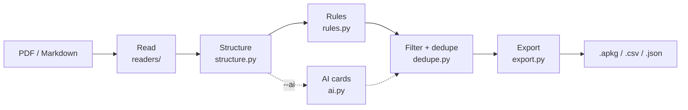

# autoflashcards: PDFs and notes to Anki decks

**A command-line tool that turns lecture PDFs, exported slides and Markdown notes into Anki flashcard decks, so a student can go from course material to spaced-repetition review in one command, and check every card against its source.**

[](https://github.com/casildata/autoflashcards/actions/workflows/pipeline.yml)


**Status:** early development (v0.1.0.dev0). PDF and Markdown input work today; PowerPoint files must be exported to PDF first.

---

## TL;DR

- **Works offline by default:** five extraction rules read PDF layout (font size, bold text, columns, multi-slide handouts) and make cards. On the evaluation set that is **100% precision and 80% recall** against 35 hand-written gold cards.
- **Optional AI stage raises recall:** adding Claude Haiku 5.5 brings recall to **94%** (precision 86%). A local Llama 3.2 3B model brings it to **97%** (precision 84%), and no text leaves the computer.
- **AI output is checked, not trusted:** each AI card must quote the line it came from, and cards that aren't grounded in the source file are dropped. A test document with a hidden instruction aimed at AI models produced **0 obeying cards** with either model.
- **Built to be audited:** every card shows its file, page and heading path, and is tagged with the rule that made it. `--json` lists every dropped card and the reason.
- **Caveat:** the evaluation documents are small and generated, built from layouts seen in real course material. Expect lower precision on real PDFs.

---

## Approach

### Pipeline



**Reading PDFs.** Reading order comes from character positions, not the file's internal text order. The page is cut recursively at its widest blank band (XY-cut), which handles single columns, two-column articles with narrow gutters, and handouts with several slides per page, all with one algorithm. Headings are found by font size relative to each page's own body text (every slide on a handout can be scaled differently) and by bold text. Running headers, footers and page numbers are removed. Bullets whose markers are pictures, which is common in exported slides, count as bullets when they are short and have no closing period.

### Rules

Each paragraph or bullet is checked against these rules in order. The first rule that matches makes the card(s), so one fact doesn't become two cards.

| Rule | Your notes say | Card |
|---|---|---|
| `term_colon` | `Osmosis: movement of water across a membrane.` (or `=`, `→`, `->`) | **Osmosis** → movement of water across a membrane. |
| `bold_lead` | **Mitosis** divides a cell into two identical cells. | **Mitosis** → divides a cell into two identical cells. |
| `definition_sentence` | A ribosome is a structure that builds proteins. | Cloze: A [...] is a structure that builds proteins. |
| `bold_term_bullets` | • **Protein kinases**<br>&nbsp;&nbsp;– Transfer phosphates from ATP to proteins | **Protein kinases** → Transfer phosphates from ATP to proteins |
| `slide_title_bullets` | Slide title *G protein-coupled receptor*, then its bullets | **G protein-coupled receptor** → its first three bullets |

- `definition_sentence` looks for "X is a / are the / was an / is defined as / is called / is known as / refers to / means …" at the start of a sentence. It skips sentences whose subject is a pronoun ("It is a…", "There are…"). A sentence that defines two terms ("Homozygous means having two identical alleles, and heterozygous means…") becomes one cloze note with two deletions, so Anki quizzes each term. It also catches a term followed by its description between commas: "{{c1::Retention}}, the share of customers who come back, is…".
- The two slide rules also work on slides exported to PDF. A card's back holds up to three bullets, one per line. `slide_title_bullets` only uses short sections made entirely of bullets (up to 8) on the slide's own page, so the headings of a textbook don't turn into list cards. It skips titles that describe a picture ("Image of…", "Example of…") and slides whose bullets are already `Term: definition` cards.
- **Skipped everywhere:** figure and table captions, labels such as `Note:` or `Keywords:`, and sections headed References, Bibliography, Table of contents, Thanks or Credits.
- **Filtered after the rules run:** cards with the same front, near-identical cards (90% similar or more) and overly long cards. `--json` lists them.

### AI cards

The rules only catch facts written in recognizable patterns. With `--ai`, the text is also sent to a language model, which can write cards from plain statements like "Producers capture energy from sunlight". Rule cards are kept first, and AI cards that repeat them are dropped as duplicates.

- **Grounding:** the model is asked to quote the line each card came from. A card is dropped if its quote isn't in your file, or if its answer is mostly words your file doesn't use, and the run reports how many were dropped. The quote also gives the card its real page and heading. Small local models often leave the quote out. Those cards are kept only if their term also comes from your file.
- **Prompt injection:** the file's text is sent as data inside `<document>` tags, the model is told not to follow instructions in it, and its reply must match a JSON schema.
- **Cost and failures:** before any request, the run prints the number of requests and an estimate of input tokens. Replies are cached on disk, so running the same file again costs nothing. A failed request skips that part of the file with a warning. A missing key, a stopped Ollama or an unknown model stops the run (exit code 2).

## Results

`eval/score.py` generates five test documents with original text, in layouts taken from real course material. It then scores the cards against hand-written gold cards, which list the facts a student should get a card for. The gold cards were written before running the tool, so they include facts no rule catches yet.

**Rules only** (reproduced by `python eval/score.py`):

| Document | Layout | Gold | Cards | Precision | Recall |
|---|---|---:|---:|---:|---:|
| handout | 4 slides per page, bullets drawn as pictures, a notes column, a chart slide | 10 | 7 | 100% | 70% |
| deck | one slide per page: divider, bold sub-terms, arrows, picture and "Questions?" slides | 6 | 5 | 100% | 83% |
| article | two columns with a narrow gutter, abstract, keywords, figure caption, references | 6 | 6 | 100% | 100% |
| textbook | single column, running header, page numbers, bold terms | 9 | 6 | 100% | 78% |
| hostile | short notes plus a hidden instruction aimed at AI models | 4 | 3 | 100% | 75% |
| **All** | | 35 | 27 | **100%** | **80%** |

**With AI cards**, on the same documents:

| | Rules only | + Claude Haiku 5.5 (`claude-code`) | + Llama 3.2 3B (`ollama`, local) |
|---|---:|---:|---:|
| Cards | 27 | 57 | 43 |
| Recall | 80% | **94%** | **97%** |
| Precision | **100%** | 86% | 84% |
| Cards obeying the hidden instruction | 0 | **0** | **0** |

- **The AI finds what the rules miss.** Both models catch the plain-statement facts. The gold set lists key terms only, so the AI cards it doesn't list were checked by hand (`eval/gold/<name>.judged.jsonl`). Most are sound, for example "Examples of abiotic factors → Temperature, water, light and soil" and "Range of an RFM score → 111 to 555".
- **What costs precision.** Most of the loss comes from repeats of rule-card facts in another form: 5 cards with each model, plus 3 Haiku cloze cards. Llama also made up definitions from a slide title or figure caption ("Energy Flow → the movement of energy through an ecosystem").
- **On a real file.** On a real 4-slides-per-page lecture handout, the AI stage took the deck from 19 to 36 cards in one request.

*Precision* is the share of cards that match a gold card or were judged correct by hand. Repeats, wrong cards and cards with no verdict yet (*unjudged*) count against it. *Recall* is the share of gold cards found. One cloze note with two deletions can find two.

## Limitations & lessons learned

- **The evaluation set is small and generated.** It has 35 gold cards across five documents, and I wrote and hand-judged them myself. It catches regressions well, but real PDFs are messier, so expect lower precision on your own files. You can score your own documents with `--private` (see [Evaluate](#evaluate)).
- **Plain statements need the AI stage.** Facts like "Dominant alleles hide the effect of recessive ones" have no pattern a rule can use. Telling them apart from any other sentence needs grammar analysis or a language model.
- **Grounding catches made-up text, not every wrong fact.** A small model can combine words that really are in the file into a wrong claim, and the word-overlap check can't catch that.
- **Scanned PDFs produce no cards.** Pages that are images with no text layer need OCR, which isn't built yet.
- **Sub-bullets aren't told apart from bullets in PDFs,** so a bold term's back is "the bullets after it, up to the next bold term or slide".
- **Rejected on licensing:** PyMuPDF (AGPL) and LayoutLMv3 (non-commercial weights) would conflict with shipping under MIT. That is why the layout analysis is rule-based on top of pdfplumber.

## Getting started

### Requirements

- Python 3.11 or newer. CI tests 3.11 and 3.14 on Linux and Windows.
- [Anki](https://apps.ankiweb.net) to study the decks. The `--csv` export needs Anki 2.1.55+.
- Optional, for AI cards: Claude Code, an Anthropic API key, or Ollama (see [AI cards](#ai-cards-optional)).

### Install

From a clone of this repository:

```bash
pip install .
```

### Run

```bash
autoflashcards lecture3.pdf                                        # writes lecture3.apkg
autoflashcards week1.md week2.pdf --deck "Bio 101" --out bio.apkg
```

If any cards were dropped, the run says how many and why (for example `Dropped 3 card(s): 2 same front as an earlier card, 1 too long`), so you know when to look at the `--json` file.

Then in Anki: **File → Import**, and pick the `.apkg` file.

| Option | Does |
|---|---|
| `--out FILE` | Where to write the deck (default: the first input's name, `.apkg`) |
| `--deck NAME` | Deck name in Anki (default: the first input's name) |
| `--csv` | Also write a `.csv` for Anki's text import (Anki 2.1.55+, built-in Basic and Cloze note types) |
| `--json` | Also write a `.json` with everything extracted, every card, and every dropped card with the reason. It is written even when no cards are found, which is when it helps most |
| `--rules a,b` | Use only these rules (see [Rules](#rules)) |
| `--ai claude` / `claude-code` / `ollama` | Also make cards with a language model (see [AI cards](#ai-cards-optional)) |
| `--model NAME` | Model for `--ai` (default: `claude-haiku-5-5`, or `llama3.2` for Ollama) |

### AI cards (optional)

```bash
pip install ".[ai]"
autoflashcards lecture3.pdf --ai claude-code   # your Claude Pro or Max plan, through Claude Code
autoflashcards lecture3.pdf --ai claude        # Anthropic API: needs ANTHROPIC_API_KEY and API credit
autoflashcards lecture3.pdf --ai ollama        # a local model: nothing leaves your computer
```

| Backend | Needs | Pays with |
|---|---|---|
| `claude-code` | [Claude Code](https://code.claude.com) installed and logged in | your Claude Pro/Max plan's usage limits; no API key |
| `claude` | `ANTHROPIC_API_KEY` from [the Console](https://console.anthropic.com) | prepaid API credit (Pro doesn't include any) |
| `ollama` | [Ollama](https://ollama.com) running, `ollama pull llama3.2` | nothing; runs on your computer (a 3B model fits a 6 GB GPU) |

- **Privacy:** `--ai claude` and `--ai claude-code` send your file's text to Anthropic, and a notice says so the first time. `--ai ollama` talks only to Ollama on your computer (set `OLLAMA_HOST` to change where).
- `claude-code` runs `claude -p` with its own system prompt, no tools (no file, shell or web access), a JSON schema for the reply and no saved session. It runs from an empty folder so your projects' `CLAUDE.md` files aren't sent.
- A chapter is a few requests to Claude Haiku 5.5. AI cards are tagged `afg::rule::ai_<backend>`.

### Evaluate

The evaluation builds its test PDFs with `reportlab`, which is in the `dev` extra:

```bash
pip install -e ".[dev]"
python eval/score.py              # writes outputs/eval.md and a deck per document
python eval/score.py --private    # scores eval/private/<name>.pdf against <name>.jsonl
python eval/score.py --ai claude  # rules + AI cards; writes outputs/eval-claude.md
python -m pytest -q               # unit tests
```

To score your own PDFs, put them in `eval/private/` (ignored by git) with a `<name>.jsonl` beside each, one `{"term": "...", "fact": "..."}` per line. CI runs the rules evaluation on every push and shows the table in the run summary. The rules + Claude evaluation runs only when started by hand, because it calls the API.

### Output

- `<name>.apkg`: the Anki deck. Add `--csv` or `--json` to also get a text-import file or a full extraction log.
- `outputs/`: evaluation reports (`eval.md`, `eval-<backend>.md`, which list every card and verdict) and the generated test PDFs and decks. This folder is ignored by git and rebuilt on each run.

## Reading your cards in Anki

**The source line.** Under each answer, a small grey line shows where the card came from: the file, the page for PDFs, and the headings the line sat under. You can use it to check a card against your notes.

```
notes.pdf · p.12 · Cells › Transport
```

**Tags.** Every card gets two kinds of tags. Anki shows `::` as a folder tree in the sidebar.

| Tag | Example | Meaning |
|---|---|---|
| Headings | `cell_biology::transport` | The headings the card came from, lowercased, with spaces turned into `_`. Click a folder in the sidebar to study one chapter or section. |
| Rule | `afg::rule::term_colon` | Which autoflashcards rule made the card (`afg` = autoflashcards). |

| Search in the Anki browser | Finds |
|---|---|
| `tag:cell_biology::transport` | Cards from the Transport section, including its subsections |
| `tag:afg::*` | Every card autoflashcards made |
| `tag:afg::rule::term_colon` | Cards from one rule, for example to review or bulk-delete them if that rule doesn't suit your notes |

**Re-importing.** Each card is identified by its deck name and its front. If you fix your notes and import again with Anki's default import settings, existing cards are updated in place and your review history is kept, so you don't get duplicates. Changing a card's front, or the deck name, makes it a new card.

## Repository structure

```
autoflashcards/
├── src/autoflashcards/
│   ├── cli.py            # the autoflashcards command
│   ├── readers/          # pdf.py (pdfplumber, XY-cut layout), markdown.py
│   ├── structure.py      # headings, bullets, headers/footers → blocks
│   ├── rules.py          # the five card rules
│   ├── ai.py             # optional AI stage: Claude API, Claude Code, Ollama
│   ├── dedupe.py         # length filters and near-duplicate removal
│   ├── export.py         # .apkg, .csv and .json writers
│   └── models.py         # Line → Block → Card types
├── eval/
│   ├── make_docs.py      # generates the five test PDFs
│   ├── score.py          # scores cards against the gold set
│   └── gold/             # hand-written gold cards and hand judgments
├── tests/                # pytest suite; make_fixtures.py builds test PDFs
├── outputs/              # generated evaluation reports and decks (git-ignored)
├── .github/workflows/    # CI: lint, tests, eval, license gate, pip-audit, gitleaks
├── CHANGELOG.md
└── pyproject.toml
```

## Skills demonstrated

`PDF layout analysis` · `Information extraction` · `LLM structured output` · `Prompt-injection defense` · `Evaluation design (precision/recall)` · `Python packaging` · `CLI design (Typer)` · `pytest` · `GitHub Actions` · `Supply-chain checks`

## Roadmap

- Tell the user when a PDF's pages have no text layer (scanned), instead of only "No cards found"; later, OCR for those pages.
- `--preview`: print the cards in the terminal without writing a deck, to try `--rules` and `--ai` choices quickly.
- Folder input (`autoflashcards course/`), with size, page and time limits per file.
- An option for the AI stage to skip text that already gave a rule card, which would cut the repeats behind most of its precision loss.
- Read PowerPoint (`.pptx`) files directly, including slide levels and speaker notes.
- Tell sub-bullets apart from bullets in PDFs.
- Grow the evaluation set with more real-world layouts.

## Author

Javier Casildo · [github.com/casildata](https://github.com/casildata)

## License

MIT. See [LICENSE](LICENSE). Dependencies are under permissive licenses (MIT, BSD, Apache-2.0, ISC, PSF), except `frozendict` (LGPL-3.0), which `genanki` needs to write `.apkg` files. It is installed as a separate, unmodified package, so it doesn't change this project's license. CI fails if any other GPL-family package, or one that states no license, is added. CI also runs `pip-audit` for known vulnerabilities and scans the history for committed secrets.
